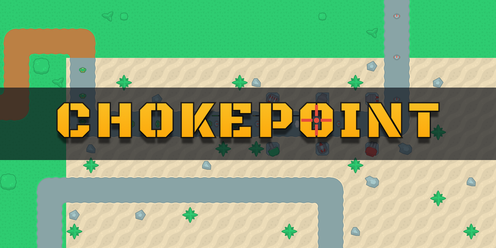
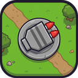
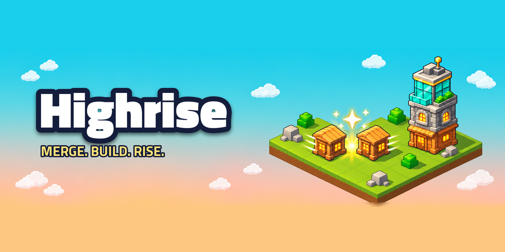
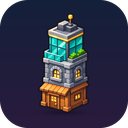

# VectorViolet

**Indie game developer. Small, finished games, built in Python and Unity.**

## Released games

<table>
  <tr>
    <td width="50%" align="center">
      
        <b><a href="https://github.com/vectorviolet/chokepoint">Chokepoint</a></b>
       Tower defense: hold the line through 25 waves, then go endless.
       Python, pygame-ce · <a href="https://umutcanekinci.itch.io/chokepoint">Play on itch.io</a>
    </td>
    <td width="50%" align="center">
      
        <b><a href="https://github.com/vectorviolet/highrise">Highrise</a></b>
       Isometric city-builder: merge buildings 2048-style and rise through four ages.
       Python, pygame-ce · <a href="https://umutcanekinci.itch.io/highrise">Play on itch.io</a>
    </td>
  </tr>
</table>

Both are v1.0, with CI, tests, Windows/macOS/Linux builds, English and Turkish, and a public devlog.

## Engine

**[pygamine](https://github.com/vectorviolet/pygamine)**: a small game-engine layer on pygame-ce (assets, panels, UI widgets, localization, saves) shared by my games.

## Game jam

<table>
  <tr>
    <td width="96" align="center"></td>
    <td>

**[Sastermate](https://github.com/vectorviolet/sastermate)**: a climate-crisis city game made with Team Climora for GameUp (HP, ICPSD and UNDP) on the COP31 theme. Put out fires, earn Carbon Points and invest in green infrastructure to keep warming below +2.0°C. I was the developer. Unity, C#. [Play on itch.io](https://umutcanekinci.itch.io/sastermate)

</td>
  </tr>
</table>

## Next up

More Unity projects, one at a time. They will be added here as they ship.

## Links

 &nbsp; 
